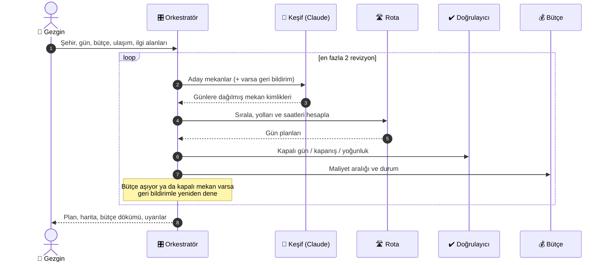
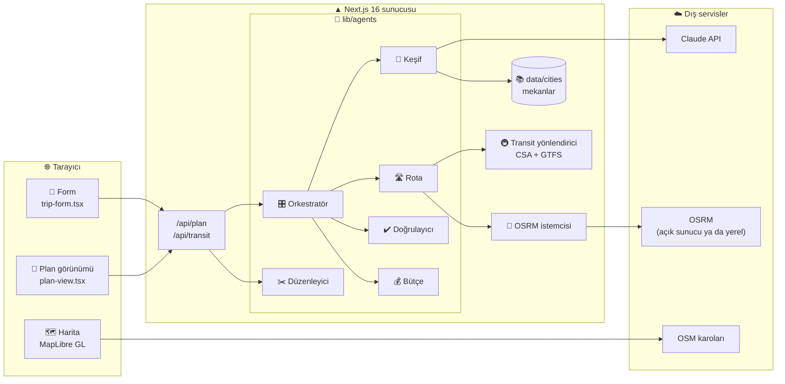

<div align="center">

# 🧭 Gezinti

### **Şehri seç, bütçeni yaz, gerisini bize bırak.**

AI ajanlarıyla **bütçeye uygun şehir gezisi planlayıcı.** Gezilecek yerleri ve yemekleri seçer, günlere böler, rotayı **gerçek sefer saatleriyle** saat saat çıkarır, bütçeyi hesaplar ve aşım riskinde uyarır.


[🚀 Hızlı başlangıç](#-hızlı-başlangıç) · [🔄 Nasıl çalışır](#-nasıl-çalışır) · [🧩 Mimari](#-mimari) · [🚇 Toplu taşıma](#-toplu-taşıma-motoru) · [📚 Belgeler](#-ayrıntılı-belgeler) · [🚩 Yol haritası](#-yol-haritası)

</div>

> [!NOTE]
> **İlk şehirler: İstanbul, İzmir ve Ankara.** Mekan fiyatları ve bazı koordinatlar şimdilik **yaklaşıktır**; belirsiz fiyatlar plana net değil **aralık** olarak girer. Yapay zekâ anahtarı yoksa uygulama **demo modunda** çalışır ve bunu planda açıkça yazar.

---

## 💡 Fikir

Şehir gezisi planlamak üç ayrı derdi birleştirir: nereye gidilir, ne kadara patlar, oraya nasıl varılır. Gezinti üçünü tek formda çözer.

| | 😰 Sorun | ✅ Gezinti'nin cevabı |
|---|---|---|
| **Ne gezeceğim?** | Yüzlerce öneri, hangisi bana uygun? | İlgi alanlarına göre **küratörlü ve popülerlikle sıralanmış** mekanlardan Claude seçer, günlere dağıtır |
| **Ne kadar tutar?** | Fiyatlar belirsiz, bütçe sürekli taşar | Her kalem **fiyat aralığı** olarak toplanır; aşım riskinde **tasarruf önerisi**, Müzekart'ın değeceği yerde **Müzekart önerisi** gelir |
| **Nasıl giderim?** | Sefer saatleri, aktarmalar, kapalı günler | Gerçek **GTFS sefer saatleriyle** yürüme + biniş + aktarma; kapalı gün ve kapanış saati **doğrulanır** |
| **Bir yer hoşuma gitmedi** | Tüm planı baştan kurmak | Tek bir durağı **çıkar** ya da **benzeriyle değiştir**; diğer günler korunur |

---

## 🔄 Nasıl çalışır

1. 📝 **Form:** Şehir, gün sayısı, başlangıç tarihi, kişi sayısı, toplam bütçe (konaklama hariç), ulaşım (toplu taşıma / araba), ilgi alanları ve isteğe bağlı not. Müzekart'ın varsa onu da işaretlersin.
2. 🔎 **Keşif:** Claude, yalnızca şehrin hazır aday listesinden seçim yapar; dönen her mekan kimliği veritabanına karşı doğrulanır, **uydurma mekan çıkmaz.**
3. 🛣️ **Rota:** Seçilen yerler günlere göre sıralanır, yolculuklar hesaplanır, öğünler uygun saatlere yerleştirilir.
4. ✔️ **Doğrulama:** Kapalı günler, kapanış saatleri ve aşırı yoğun günler kontrol edilir.
5. 💰 **Bütçe:** Maliyet toplanır, durum belirlenir (`rahat` · `yaklaşıyor` · `aşabilir` · `aşıyor`).
6. 🔁 **Geri bildirim:** Plan bütçeyi aşıyorsa ya da kapalı bir yer içeriyorsa sorun keşif ajanına iletilir ve plan yeniden kurulur (**en fazla 2 tur**).
7. 🗺️ **Sonuç:** Gün gün zaman çizelgesi, haritada güzergâhlar, bütçe dökümü ve uyarılar.



> 🧮 **Sayısal işler (mesafe, süre, maliyet) deterministik koddadır.** Claude yalnızca seçim yapar ve açıklama yazar. `ANTHROPIC_API_KEY` yoksa ya da çağrı başarısız olursa **sezgisel yedek yönteme** düşülür ve plan bunu belirtir.

---

## ✨ Özellikler

| | Özellik | Kısaca | Belge |
|---|---|---|---|
| 🤖 | **Çok ajanlı planlama** | Orkestratör + keşif + rota + doğrulayıcı + bütçe ajanları; bütçe/kapalı mekan için otomatik yeniden deneme | [Mimari](#-mimari) |
| 🚇 | **Gerçek sefer saatli toplu taşıma** | GTFS üzerinde Connection Scan Algorithm; metro, tramvay, Marmaray, vapur, otobüs, Metrobüs... | [Toplu taşıma verisi](docs/toplu-tasima-verisi.md) |
| 🚶 | **Yürüme ve araba rotaları** | OSRM ile gerçek yol; araba süresine ×1,5 trafik çarpanı + otopark süresi | [Rotalama ve harita](docs/rotalama-ve-harita.md) |
| 💰 | **Aralık tabanlı bütçe** | Net fiyat tek değer, tahmini fiyat aralık; kalem kalem döküm (etkinlik, yemek, ulaşım, otopark) | [Bütçe](#-bütçe) |
| 🎫 | **Müzekart** | Müzekart varsa geçen yerler ücretsiz sayılır; yoksa ve değiyorsa alma önerisi | [Bütçe](#-bütçe) |
| 🍽️ | **Öğün yerleştirme** | Kahvaltı, öğle (11:45–14:00), akşam yemeği uygun saatlere, güzergâha yakın mekanlarla | [Mimari](#-mimari) |
| ✂️ | **Tek durak düzenleme** | Planda bir durağı çıkar ya da benzer bir mekanla değiştir; AI yeniden çağrılmaz | [Düzenleme](#-plan-düzenleme) |
| 🗺️ | **Etkileşimli harita** | MapLibre GL + OSM; gerçek güzergâh düz, tahmini kesikli çizgi | [Rotalama ve harita](docs/rotalama-ve-harita.md) |
| 🕐 | **Açılış saati doğrulama** | Kapalı gün ve kapanış saati kontrolü; gece yarısından sonra kapananlar doğru ele alınır | [Mimari](#-mimari) |
| 🛡️ | **Yedek mod** | AI anahtarı yoksa veya çağrı başarısızsa yerel sezgisel planlama | [Çalıştırma](#-ortam-değişkenleri) |
| 🎨 | **El yazısı defter arayüzü** | Kobalt zemin, etiket kutulu başlıklar, sürüklenebilir çıkartmalar, el yazısı notlar | [Arayüz](#-arayüz) |

---

## 🧩 Mimari



### 🤖 Ajanlar

| Ajan | Dosya | Görev |
|---|---|---|
| 🎛️ Orkestratör | [`lib/agents/orchestrator.ts`](lib/agents/orchestrator.ts) | Döngüyü yönetir; bütçe aşımı veya kapalı mekan varsa keşfi geri bildirimle yeniden çalıştırır (en fazla 2 tur) |
| 🔎 Keşif | [`lib/agents/discovery.ts`](lib/agents/discovery.ts) | Claude ile aday listesinden mekan seçer, günlere dağıtır, kısa notlar yazar; dönen kimlikleri doğrular. Anahtar yoksa sezgisel yönteme düşer |
| 🛣️ Rota | [`lib/agents/route.ts`](lib/agents/route.ts) | **En yakın komşu + 2-opt** ile sıralar; yürüme/toplu taşıma/araba ayaklarını, saatleri ve öğünleri hesaplar |
| ✔️ Doğrulayıcı | [`lib/agents/validator.ts`](lib/agents/validator.ts) | Kapalı gün, kapanış saati ve aşırı yoğun günleri (gün sonu 22:30, yolda 180 dk üstü) kontrol eder |
| 💰 Bütçe | [`lib/agents/budget.ts`](lib/agents/budget.ts) | Maliyetleri aralık olarak toplar, durum ve tasarruf önerisi üretir, Müzekart'ı değerlendirir |
| ✂️ Düzenleyici | [`lib/agents/editor.ts`](lib/agents/editor.ts) | Tek durağı çıkarır ya da yakınlık + popülerlik + kategoriyle yerine koyar |

### 🔌 API

| Uç nokta | Yöntem | Ne yapar |
|---|---|---|
| `/api/plan` | `POST` | Yeni plan üretir. Gövdede `edit` varsa mevcut planda tek durak düzenler. İstek [zod](https://zod.dev) ile doğrulanır |
| `/api/transit` | `GET` | Toplu taşıma yönlendiricisini tek başına dener (`city`, `fromLat`, `fromLng`, `toLat`, `toLng`, `time`, `weekday`) |

```bash
# Yönlendiriciyi tek başına dene (veri kurulu olmalı)
curl "http://localhost:3000/api/transit?city=istanbul&fromLat=41.0082&fromLng=28.9784&toLat=41.0369&toLng=28.9850&time=10:30&weekday=2"
```

---

## 🚇 Toplu taşıma motoru

[`lib/transit/router.ts`](lib/transit/router.ts), **Connection Scan Algorithm** ile o saatteki **gerçek seferlere** göre yürüme + biniş + aktarma adımlarından oluşan yolculuk bulur. Ek sunucu gerekmez; derlenmiş tarife bellekte tutulur.

| Şehir | Kapsam | Kaynak |
|---|---|---|
| 🇹🇷 **İstanbul** | Metro, tramvay, Marmaray, füniküler, teleferik, vapur, İETT otobüsü, Metrobüs | İBB Açık Veri (GTFS) + Metro İstanbul web servisi (güncel saatler) |
| 🇹🇷 **İzmir** | ESHOT, Metro, Tramvay, İZBAN | Kurumların GTFS yayınları |
| 🇹🇷 **Ankara** | EGO otobüs, Metro, Ankaray, Başkentray | EGO "Hareket Saatleri" sayfası + OpenStreetMap (Ankara'nın açık GTFS'i yok) |

- Her biniş karşılaştırmada **5 dk ceza** alır, az aktarmalı rota tercih edilir.
- Her biniş tam bilet sayılır; İstanbulkart aktarma indirimi hesaba katılmaz.
- Güzergâh çizgileri OSM ray ağı ve otobüs hat ilişkilerinden kurulur; olmayanlar OSRM yol eşleştirmesine ya da düz çizgiye düşer.
- Ankara yolculukları planda **"tahmini"** işaretlenir.
- Veri yoksa toplu taşıma ayakları kuş uçuşu tahminle hesaplanır, uygulama yine çalışır.

> [!IMPORTANT]
> **Toplu taşıma verisi git'te yoktur** (üç şehir için ~195 MB, `.gitignore`'da). Gerçek hat numarası, saat ve harita çizgisi için veriyi kurmanız gerekir: [KURULUM.md](KURULUM.md). Üretim hattının tamamı: [Toplu taşıma verisi](docs/toplu-tasima-verisi.md).

---

## 💰 Bütçe

- Her kalem `{ min, max, confidence }` aralığıdır; `confidence` **`net`** (güncel ve doğrulanmış) ya da **`tahmini`** olur. Son doğrulama tarihi de tutulur.
- **Kalemler:** etkinlik/giriş, yeme-içme, ulaşım, otopark (arabada gün başına).
- **Durum**, tahmini **üst sınırın** bütçeye oranına göre belirlenir: `rahat` → `yaklaşıyor` (≥ %80) → `asabilir` → `asiyor`.
- Aşım riskinde en çok tasarruf sağlayan duraklar önerilir.
- Giriş ücretleri **T.C. vatandaşı (yerli) tarifesidir** ve tek yerden okunur ([`lib/pricing.ts`](lib/pricing.ts)). Müzekart (yıllık 200 TL) geçen yerler kartı olanlar için ücretsiz sayılır; kartı olmayana, plandaki biletler kartın fiyatını aşıyorsa Müzekart alması önerilir.

---

## ✂️ Plan düzenleme

Plan beğenilmediğinde baştan kurmaya gerek yoktur. Bir durak için **çıkar** ya da **değiştir** seçilir:

- **Çıkar:** durak plandan silinir.
- **Değiştir:** aynı günün açılış saatine uyan, **henüz planda olmayan** en uygun mekan seçilir. Seçimde popülerlik ile yakınlık dengelenir (1 puan ≈ 1,5 km) ve aynı kategoriye bonus verilir; yeme-içme yerine yeme-içme gelir.
- Diğer günler ve duraklar korunur; rota, doğrulama ve bütçe yeniden hesaplanır. **AI çağrısı yapılmaz.**

---

## 📚 Veri

Şehir verileri [`data/cities/`](data/cities) altındadır ve [`lib/types.ts`](lib/types.ts) şemasıyla (zod) doğrulanır.

| Şehir | Mekan sayısı | Dosyalar |
|---|---|---|
| İstanbul | 87 | `istanbul.ts`, `istanbul.places.json` |
| İzmir | 42 | `izmir.ts`, `izmir.places.json` |
| Ankara | 45 | `ankara.ts`, `ankara.places.json` |

- 🏛️ **Gezilecek yerler:** OpenStreetMap'te Wikidata bağlantısı olan yerler, **Wikipedia popülerliğiyle** sıralanır (kaç dilde maddesi var + son 12 ay tr/en görüntülenme).
- 🍴 **Yeme-içme:** açık veride puan olmadığından köklü ve yaygın tavsiye edilen mekanlar elle derlenir ve OSM'de doğrulanır; **Michelin** ödülleri işaretlenir.
- 📍 **Koordinat doğrulama:** elle girilmiş (`kurator`) mekanlar `node scripts/verify-coords.mjs` ile OSM'e karşı denetlenir. [Ayrıntı](docs/rotalama-ve-harita.md#koordinat-doğrulama)
- ⚖️ **Lisanslar:** OSM verisi **ODbL** (atıf gerekir), Wikidata ve Wikimedia Pageviews **CC0**.

```bash
npm run places:fetch                      # tüm şehirlerin mekan listesini yeniden üretir
node scripts/fetch-places.mjs istanbul    # tek şehir
```

---

## 🎨 Arayüz

[`app/`](app) altında Next.js App Router ile yazılmıştır: kobalt ızgara zeminli hero, etiket kutularında kalın italik başlıklar, sürüklenebilir çıkartmalar ve el yazısı notlar. Şehir seçimine göre değişen notlar (ör. ulaşım) forma rehberlik eder.

| Dosya | Görev |
|---|---|
| `page.tsx` | Açılış sayfası (hero, çıkartmalar) |
| `planner.tsx` | Form + sonuç akışını yönetir |
| `trip-form.tsx` | Gezi formu |
| `plan-view.tsx` | Gün gün plan, bütçe dökümü, uyarılar, düzenleme |
| `plan-map.tsx` | MapLibre harita ve güzergâh çizgileri |
| `stickers.tsx`, `note.tsx`, `motion.tsx`, `icons.tsx` | Dekoratif öğeler, notlar, animasyonlar, ikonlar |

---

## 📁 Proje yapısı

```
gezinti/
├─ app/                 Next.js arayüzü ve API rotaları
│  └─ api/              plan (POST) ve transit (GET) uç noktaları
├─ lib/
│  ├─ agents/           orkestratör, keşif, rota, doğrulayıcı, bütçe, düzenleyici (+ testler)
│  ├─ transit/          Connection Scan yönlendirici ve GTFS okuyucu
│  ├─ routing/          OSRM istemcisi (yürüme/araba, önbellek, kuş uçuşu yedek)
│  ├─ data/             şehir kayıt defteri
│  ├─ pricing.ts        giriş ücretleri ve Müzekart
│  ├─ geo.ts            mesafe, saat, fiyat aralığı yardımcıları
│  └─ types.ts          tüm şemalar (zod) ve plan tipleri
├─ data/cities/         üç şehrin mekan verisi
├─ scripts/             GTFS derleme, OSM/EGO/Metro İstanbul indirme, doğrulama betikleri
├─ docs/                ayrıntılı teknik belgeler
├─ test/                test verileri (GTFS yapay veri, EGO sayfası örneği)
├─ docker-compose.osrm.yml   yerel OSRM sunucuları (isteğe bağlı)
└─ .github/workflows/ci.yml  tip kontrolü, lint, test, derleme
```

---

## 🧰 Teknoloji yığını

| Katman | Teknolojiler |
|---|---|
| 🖥️ **Arayüz** | Next.js 16 (App Router, Turbopack), React 19, Tailwind CSS 4, MapLibre GL |
| 🤖 **Yapay zekâ** | Anthropic SDK, Claude (`claude-opus-5-5`); yalnızca seçim ve açıklama |
| ✅ **Doğrulama** | zod 4 (istek, şehir verisi ve AI çıktısı şemaları) |
| 🚇 **Toplu taşıma** | GTFS, Connection Scan Algorithm, A* (ray ağı), Overpass/OSM |
| 🚗 **Yol rotaları** | OSRM (açık FOSSGIS sunucusu ya da yerel Docker) |
| 🧪 **Test ve kalite** | Vitest 5, ESLint 9, TypeScript 5, GitHub Actions |

---

## 🚀 Hızlı başlangıç

### 📋 Gereksinimler

- 🟢 **Node.js 24** ve npm
- 🌿 Git
- 🌐 İnternet: harita karoları OpenStreetMap'ten, yol rotaları açık OSRM sunucusundan gelir
- *(İsteğe bağlı)* 🔑 Anthropic API anahtarı: AI planlama için
- *(İsteğe bağlı)* 🐳 Docker: yerel OSRM için

### ▶️ Kurulum

```bash
git clone https://github.com/emirmusakaraduman/gezinti.git
cd gezinti
npm install     # MapLibre worker dosyasını public/maplibre/ altına da kopyalar
npm run dev
```

Sonra **http://localhost:3000** adresini açın.

Bu haliyle uygulama açılır ve plan üretir; **toplu taşıma ayakları kuş uçuşu tahminle** hesaplanır. Gerçek hat ve saatler için toplu taşıma verisini kurun: [KURULUM.md](KURULUM.md).

### 🔑 Ortam değişkenleri

`.env.local` dosyası (git'te yoktur). **Hiçbiri zorunlu değildir.**

| Değişken | Varsayılan | Ne yapar |
|---|---|---|
| `ANTHROPIC_API_KEY` | yok | Claude ile planlama. Yoksa **demo modu** (yerel sezgisel planlama) |
| `OSRM_CAR_URL` | açık FOSSGIS sunucusu | Araba rotaları için kendi OSRM adresin |
| `OSRM_FOOT_URL` | açık FOSSGIS sunucusu | Yürüme rotaları için kendi OSRM adresin |

> [!TIP]
> `OSRM_CAR_URL` ulaşılamayan bir adrese işaret ederse araba rotaları tahmine düşer. Yerel sunucun yoksa değişkeni hiç tanımlama.

### 💻 Komutlar

| Komut | Ne yapar |
|---|---|
| `npm run dev` | Geliştirme sunucusu |
| `npm run build` / `npm start` | Üretim derlemesi / sunucusu |
| `npm test` | Vitest testleri (veri olmasa da geçer, gerçek veri testleri atlanır) |
| `npm run lint` | ESLint |
| `npm run gtfs:build` | Ham verilerden `data/gtfs/build/*.bin` tarifelerini derler |
| `npm run places:fetch` | Şehir mekan listelerini açık verilerden yeniden üretir |

CI ([`ci.yml`](.github/workflows/ci.yml)) her push ve pull request'te şunları çalıştırır: rota tipleri üretimi → `tsc --noEmit` → lint → test → üretim derlemesi.

---

## 🔒 Bilinen sınırlar

- 💸 **Fiyatlar ve koordinatlar yaklaşıktır;** belirsiz fiyatlar aralık olarak gösterilir, kesin tutar değildir. Giriş ücretleri yerli tarifesidir.
- 🕰️ **Bazı toplu taşıma kaynakları eskidir:** İstanbul'da Marmaray/Şehir Hatları vapurları ve M7 (servis Mecidiyeköy-Çağlayan kesimini vermiyor), İzmir'de İZBAN ve ESHOT eski GTFS ile çalışır. Plan, tarifesi bitmiş kaynakları uyarıyla belirtir.
- 📅 Takvim tarihi yerine **haftanın günü** kullanılır; gece yarısını aşan yolculuklar desteklenmez; minibüs ve taksi-dolmuş hariçtir.
- 🚌 Ankara'da EGO'nun bazı durakları OSM'de karşılığı olmadığı için (~%31–35) hattan çıkarılır; ara durak süreleri mesafeyle dağıtılmış tahmindir, kalkış saatleri gerçektir.
- 🚗 Araba süreleri OSRM'in trafiksiz süresine ×1,5 çarpanı uygulayarak tahmin edilir.
- 🌐 Varsayılan OSRM sunucusu **demo amaçlıdır;** yoğun kullanım için kendi sunucunuzu kurun (`docker-compose.osrm.yml`).

---

## 🚩 Yol haritası

- [x] 🧱 Üç şehir için küratörlü mekan verisi ve zod şemaları
- [x] 🤖 Çok ajanlı planlama: keşif, rota, doğrulayıcı, bütçe, orkestratör
- [x] 🛡️ AI yokken yedek sezgisel mod ve demo modu
- [x] 🚇 Connection Scan ile GTFS toplu taşıma (İstanbul, İzmir, Ankara)
- [x] 🛤️ OSM'den raylı hat ve otobüs güzergâh çizgileri
- [x] 🚗 OSRM ile yürüme ve araba rotaları
- [x] 🎫 Müzekart desteği ve bütçe aralıkları
- [x] ✂️ Tek durak çıkarma/değiştirme
- [x] 🗺️ MapLibre haritası
- [x] 🧪 CI: tip kontrolü, lint, test, derleme
- [ ] 🔄 Güncel kaynak bulunduğunda eski GTFS verilerinin yenilenmesi (Marmaray, Şehir Hatları, M7, İZBAN, ESHOT)
- [ ] 🚌 Ankara'da OSM'de karşılığı olmayan durakların tamamlanması
- [ ] 🏙️ Yeni şehirler

---

## 📚 Ayrıntılı belgeler

Bu README özettir; ayrıntılar aşağıdadır.

| 📄 Belge | İçerik |
|---|---|
| [🚇 Toplu taşıma verisi](docs/toplu-tasima-verisi.md) | GTFS kaynakları, İstanbul/İzmir/Ankara veri hattı, Metro İstanbul ve EGO, raylı ve otobüs çizgileri, sınırlar |
| [🗺️ Rotalama, harita ve koordinat doğrulama](docs/rotalama-ve-harita.md) | OSRM, trafik çarpanı, MapLibre, `verify-coords` |
| [💻 Başka bilgisayarda kurulum](KURULUM.md) | Hazır veriyi taşıma, sıfırdan üretme, doğrulama, sık sorunlar |

---

## 📄 Lisans

Henüz bir lisans dosyası eklenmedi. Kullanılan veriler kendi lisanslarına tabidir: OpenStreetMap © katkıda bulunanlar (ODbL), Wikidata ve Wikimedia Pageviews (CC0); toplu taşıma verileri İBB Açık Veri, EGO, ESHOT, İzmir Metro, Tram İzmir ve İZBAN kaynaklarından alınır.
